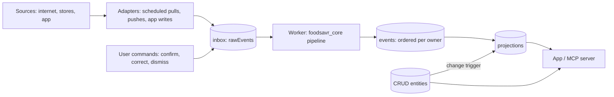

# ADR 0005: Hybrid event log and CRUD

## Status

Accepted (explicit owner intent, recorded in session 2026-11-21). Spec-ahead: nothing below is built.

Amended November 22, 2026 with the transition phase "Inbox first" (owner intent on #322, which satisfies ADR 0002 for that section). The transition phase starts building the inbox before the worker exists; everything outside that section stays spec-ahead.

## Context

The target is automation: users barely edit data. Most state derives from raw data imported from the internet or from events in stores (receipts, loyalty transactions, orders, scans). Only data with no raw source behind it needs to be user-editable. `generate_shopping_list` ([contracts/mcp-tools.yaml](../contracts/mcp-tools.yaml)) also needs consumption history, which overwrite-in-place CRUD loses.

Plain CRUD loses history and lets user edits collide with re-imports. Full event sourcing with a message bus and CQRS everywhere is overkill for one household's volume, and the confidence gate (#193) is a synchronous user step.

## Decision

### Classify every piece of data by origin

| Class | Examples | Style | User writes |
|---|---|---|---|
| Raw input | receipts, loyalty transactions, store events, orders, scans, free text, user commands | Inbox: create-only, idempotent, unordered | Create only |
| Domain events | purchased, consumed, discarded, transferred, confirmed, corrected, dismissed | Ordered event log per owner | Never |
| Derived state | inventory, consumption history, expiry, shopping list, activity feed | Projections rebuilt from the event log | Never (read only) |
| User-authored | recipes, meal plans, groups, preferences, collection names, product catalogue notes | CRUD | Read/write |

Shapes: [contracts/raw-event.schema.json](../contracts/raw-event.schema.json) and [contracts/domain-event.schema.json](../contracts/domain-event.schema.json).

### Flow

### Rules

1. **Derived data is never edited directly.** Confirm, correct and dismiss are user commands that enter the inbox. They become domain events, so they survive projection rebuilds.
2. **CRUD feeds projections.** A change to a user-authored entity (e.g. a meal plan) triggers recomputation of the projections that read it. This is the only coupling between the two halves.
3. **One read model.** The UI and MCP server read projections plus CRUD entities: an activity feed (event log), inventory and shopping list (projections), and the confidence-gate queue (#193).
4. **Coarse events.** One import is one event (e.g. one receipt with N line items), not N events.
5. **Idempotent inbox.** A raw event's document ID is its idempotency key `source:provider:externalId`. Re-importing is a no-op.
6. **Single sequencer.** Only the worker appends domain events. It assigns `seq`, which increases strictly per `ownerId`, in a transaction. Clients never assign `seq`, so offline clients can still queue inbox writes.

### Storage and delivery (Firestore-first)

| Path | Writer | Notes |
|---|---|---|
| `owners/{ownerId}/rawEvents/{idempotencyKey}` | client (create only), worker | Offline-queued by the Firestore SDK |
| `owners/{ownerId}/events/{seq}` | worker only | Append-only, ordered |
| `owners/{ownerId}/projections/{name}` | worker only | Checkpoint doc: `lastAppliedSeq`, `version` |
| `owners/{ownerId}/{projection}_v{n}/{id}` | worker only | Projection rows, one doc per item |

`ownerId` is a user or a group (#197).

- **Triggers are wake-up signals only.** Delivery is at-least-once and unordered. On any trigger, a projector reads `seq > lastAppliedSeq` for the owner and applies those events and the new checkpoint in one transaction. This handles duplicates, reordering and gaps with one mechanism.
- **Write limits.** About 1 sustained write per second per document. Projection rows are per item, so they are rarely hot. Aggregates (totals, a shopping list stored as one doc) are computed on read, or debounced through a Cloud Task named after the owner and projection.
- **Rebuilds.** A projection is rebuilt into `{projection}_v{n+1}`, and readers then switch over. Rebuilds for one owner fit in a normal handler. Full rebuilds run as a Cloud Run Job or chained Cloud Tasks, because event-driven functions time out after 9 minutes.

### Worker placement

The pipeline and projectors must run `foodsavr_core` (Dart). Writing them in TypeScript or Python would duplicate core logic and break the boundary in [architecture.md](../architecture.md). The worker is therefore a Dart service on Cloud Run, co-located with the MCP server (#171):
- Firestore triggers reach it through Eventarc.
- Scheduled pulls from loyalty APIs run through Cloud Scheduler.

### Scale-out path (not adopted)

If cross-owner queries or analytics become a real need, the event log moves to Postgres (Data Connect / Cloud SQL) with a `UNIQUE (stream_id, sequence_num)` constraint, and Firestore keeps only the projections. The projector rules above stay the same. It is deferred for two reasons:
- Cloud SQL is billed continuously and does not scale to zero.
- Clients cannot append to it offline.

## Transition phase: inbox first

Rule 6 needs a server runtime (#321), so the worker cannot exist on Spark. Waiting would leave the app with no consumption history, which #195, #288 and every waste or spend insight need. Until the exit criteria below hold, the client writes the inbox and the worker's job is deferred. Rejected alternatives: waiting for the worker (no history until Blaze and Cloud Run exist), and client-assigned `seq` (violates rule 6 and makes offline clients race).

1. **Client inbox writes.** The client creates `owners/{uid}/rawEvents/{source:provider:externalId}` documents, create-only and idempotent (rule 5), shaped by [contracts/raw-event.schema.json](../contracts/raw-event.schema.json). A null `provider` is written as `app` in the key. `ownerId` is the signed-in user; groups (#197) are out of scope. The Firestore SDK queues the writes offline.
2. **First types.**
   - User commands: `source: userCommand` with `payload.type` of `consumed` or `discarded`. `externalId` is a client UUID generated once per user action. The payload carries a snapshot (`productName`, `barcode`, `category`) so the history survives deleting the product.
   - Imports: `receipt` (`externalId` is the receipt hash) and `loyaltyApi` store transactions (`provider` is the store, `externalId` is the transaction ID). Their payloads stay opaque to everything but their adapter.
3. **CRUD stays the read model.** `products` keeps being edited directly during the transition, a documented exception to rule 1. An action that changes `products` and records a command writes both in one Firestore batch, so the product edit and its inbox entry commit or fail together, including offline.
4. **No `seq` on the client.** Clients never write `events`, projections, `processedSeq` or `seq`. The client may derive read-only views (for example consumption history for #195) from the inbox. Those views are replaceable and are never persisted as events.
5. **Projector placement.** The first projector runs on the device and reads the inbox. When the worker exists, it takes over the same derivation. It first replays the whole inbox ordered by `receivedAt`, then by `id`, assigns `seq` (rule 6) and sets `processedSeq`.
6. **Insights read the inbox** until projections exist.

### Exit criteria

The transition ends, and `products` stops being edited by the client (rule 1 applies in full), when all of these hold:

1. The worker (#321) runs on Cloud Run on Blaze.
2. The worker has replayed the inbox into `events`, and an `inventory` projection matches the `products` rows for the owner.
3. The app reads inventory and consumption from projections, and user edits to derived data go through commands (`corrected`, `dismissed`).
4. `products` is split into a derived inventory projection and a user-authored catalogue (see Consequences).

### Firestore rules

Rules are untracked and owner-applied through `FIRESTORE_RULES_B64`. The proposal lives in the pull request for #322 and on the issue. It lets the owner create an inbox document and forbids update and delete. Clients have no access to `events` or projections yet, so the default deny applies.

## Consequences

- `products` today mixes imported rows with user-edited data. It splits into a derived inventory projection and a user-authored product catalogue. Migration is tracked separately and needs approval (ADR 0003).
- New spec-ahead shapes live in `contracts/` and are not validated by `check_shape_sync.dart`. Each moves to `schemas/` with a code anchor once implemented.
- Firestore rules must enforce: inbox create-only for owners; events and projections read-only for clients. During the transition phase only the inbox rule is required.
- Cloud Functions support for Dart was not verified. If it becomes usable, the worker could move there without changing these rules.
